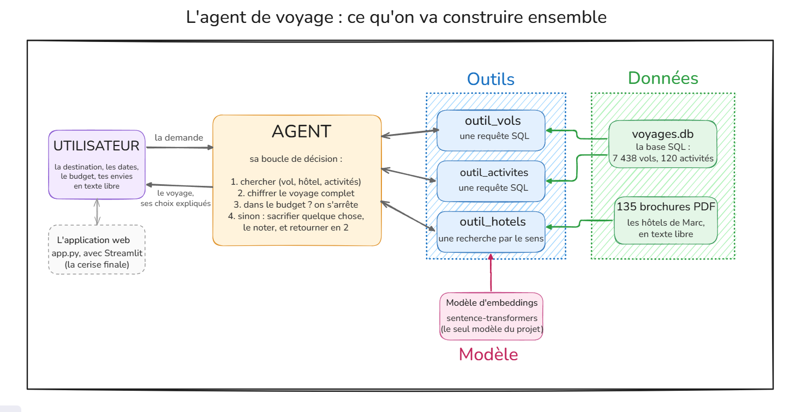

# Projet fédérateur : le monde des Agents IA

**MPSDD2 · Année universitaire 2026-2027 · Encadrante : Dr. Hela Haj Mohamed**

**Présenté par : Khadija Yakouba Dogon Yaro** ([@KADY2004](https://github.com/KADY2004))

> Concevoir, outiller, évaluer et déployer un agent IA, à travers un cas d'étude complet : un agent qui planifie un voyage sous contrainte de budget.

<div align="center">

</div>

## Présentation

Trois partenaires d'une agence de voyage fictive détiennent chacun une partie des données : les vols (une base SQL), les hôtels (135 brochures PDF) et les activités (une table SQL). Votre équipe construit un **agent** qui, à partir d'une demande (« Madrid, du 12 au 16 août, 1000 euros, on aime les musées »), compose le voyage complet, arbitre quand le budget ne suffit pas, explique ce qu'il a sacrifié, s'évalue sur un banc d'essai et réserve, mais seulement après confirmation humaine.

Le projet est **fédérateur** : il mobilise dans un même système le SQL, le traitement du langage (embeddings), l'algorithmique de décision, l'évaluation expérimentale, le déploiement web, l'IA générative et l'éthique de l'IA.

## Objectifs pédagogiques

À l'issue du projet, l'étudiant est capable de :

1. définir rigoureusement un agent, le situer dans la typologie classique et le spécifier avec le cadre PEAS ;
2. concevoir des outils fiables pour un agent, sur des données structurées (SQL paramétré) et non structurées (embeddings) ;
3. décrire ces outils sous forme de schémas, comme le font les LLM modernes (*tool calling*) ;
4. programmer une boucle de décision qui arbitre sous contrainte, se rattrape et explique ses choix ;
5. évaluer un agent sur une batterie de scénarios, avec des invariants et des indicateurs ;
6. encadrer les actions d'un agent par des garde-fous (confirmation humaine, moindre privilège) ;
7. déployer l'agent dans une application web ;
8. brancher un LLM comme orchestrateur des outils, puis en discuter les apports et les risques.

## Prérequis

- Python et pandas ;
- SQL : `SELECT`, `WHERE`, `GROUP BY`, `ORDER BY`, `INSERT` ;
- notions d'embeddings et de similarité cosinus ;
- Git.

Aucune connaissance préalable des LLM n'est nécessaire : les modules 0 à 9 n'en utilisent aucun.

## Contenu du dépôt

```
Projet_Federal_Agent_IA/
├── projet_federateur.ipynb   # le notebook du projet : 12 modules, 14 exercices auto-corrigés
├── app.py                    # l'application web Streamlit (exercice 9)
├── utils.py                  # la plomberie : base, PDF, encodeur, affichages, client simulé
├── data/
│   ├── voyages.db            # base SQLite : vols, activités, réservations (données fictives)
│   └── hotels/               # 135 brochures PDF d'hôtels (données fictives)
├── architecture.png          # le schéma de l'architecture
├── boucle_agent.svg          # le schéma de la boucle d'un agent
├── Streamlit.PNG             # une capture de l'application
├── pyproject.toml            # les dépendances (gérées par uv)
└── README.md
```

## Le parcours

| Module | Thème | Concept agentique |
|---|---|---|
| 0 | Le monde des agents IA | définition, typologie, PEAS, panorama 2026 (motifs, MCP, A2A, frameworks, risques) |
| 1 | Percevoir : les données de l'environnement | perception, exploration des données |
| 2 | Les outils SQL | outils, requêtes paramétrées, injection SQL |
| 3 | L'outil sémantique | embeddings, recherche par le sens, limites (négation) |
| 4 | Le registre d'outils | *tool calling*, schémas JSON, répartiteur robuste |
| 5 | La boucle de décision | arbitrage sous contrainte, fonction d'utilité implicite, traçabilité |
| 6 | La proactivité | exploration des jours voisins, honnêteté |
| 7 | Évaluer un agent | banc d'essai, invariants, indicateurs |
| 8 | Agir avec des garde-fous | humain dans la boucle, défaut sûr, moindre privilège |
| 9 | Déployer | application web Streamlit |
| 10 | L'agent piloté par un LLM (avancé) | boucle *tool use* avec Claude, test par simulation |
| 11 | Le travail fédérateur | extensions, livrables, soutenance |

Chaque exercice se complète entre les balises `### START CODE HERE ###` et `### END CODE HERE ###`, et se termine par des tests qui affichent *Exercice validé !*

## Installation

1. **Cloner le dépôt** :

   ```bash
   git clone https://github.com/Adnane-dev/Projet_Federal_Agent_IA.git
   cd Projet_Federal_Agent_IA
   ```

2. **Installer [uv](https://docs.astral.sh/uv/)**, le gestionnaire d'environnements Python.

   Linux, macOS ou WSL :

   ```bash
   curl -LsSf https://astral.sh/uv/install.sh | sh
   ```

   Windows (PowerShell) :

   ```powershell
   powershell -ExecutionPolicy ByPass -c "irm https://astral.sh/uv/install.ps1 | iex"
   ```

3. **Créer l'environnement** (Python et toutes les librairies du socle) :

   ```bash
   uv sync
   ```

   Pour le Module 10 (optionnel), ajoutez la librairie `anthropic` avec `uv sync --extra llm`. Il vous faudra aussi une clé d'API, exposée dans la variable d'environnement `ANTHROPIC_API_KEY`, et jamais écrite dans le dépôt.

4. **Ouvrir le notebook** `projet_federateur.ipynb` dans VS Code (extensions Python et Jupyter), puis choisir le noyau de l'environnement `.venv`.

5. **Lancer l'application** (après l'exercice 9) :

   ```bash
   uv run streamlit run app.py
   ```

## Organisation

- **Équipes** de 2 à 3 étudiants. Rôles suggérés, à faire tourner d'un jalon à l'autre : responsable *données et outils*, responsable *agent et évaluation*, responsable *produit et application*.
- **Git** : chaque équipe travaille dans son propre dépôt, créé à partir de celui-ci. Chaque membre commite régulièrement : l'historique fait partie de l'évaluation.
- **Suivi** : un point d'avancement à chaque jalon avec l'encadrante.

## Calendrier indicatif

Les dates exactes sont fixées par l'encadrante.

| Jalon | Semaine | Modules | Attendu au jalon |
|---|---|---|---|
| J1 | S1 | 0 et 1 | constitution des équipes, fiche PEAS, prise en main des données |
| J2 | S2 | 2 à 4 | outils et registre d'outils, tests au vert |
| J3 | S3 | 5 et 6 | boucle de décision et proactivité |
| J4 | S4 | 7 à 9 | banc d'essai, garde-fous, application ; **choix de l'extension validé par l'encadrante** |
| J5 | S5 et S6 | 10 et 11 | module avancé ; réalisation et mesure de l'extension |
| J6 | S7 | | rendu du dépôt et du rapport, soutenance |

## Livrables

1. **Le dépôt Git de l'équipe** : le notebook complété et exécuté, `app.py` branché, le code des extensions, un `README` à jour.
2. **Le rapport** (8 à 12 pages), qui répond aux encadrés *📝 Pour le rapport* du notebook et suit le plan suivant :
   1. problématique et fiche PEAS ;
   2. architecture ;
   3. outils ;
   4. politique de décision (et sa justification) ;
   5. évaluation : protocole, résultats, limites ;
   6. garde-fous et éthique ;
   7. extension(s) ;
   8. bilan et perspectives.
   
   En annexe : la déclaration d'usage des assistants IA.
3. **La soutenance** : 15 minutes de présentation avec une démonstration en direct, suivies de 10 minutes de questions.

## Extensions au choix (Module 11)

Au moins une extension par équipe, deux pour les équipes de trois :

| | Extension | Difficulté |
|---|---|---|
| A | Un meilleur arbitre : une fonction d'utilité explicite | ★★ |
| B | La mémoire : les préférences du voyageur | ★★ |
| C | Plusieurs agents : des spécialistes et un coordinateur, ou un agent critique | ★★★ |
| D | Comprendre le langage : extraction de la demande, négation, dialogue | ★★ |
| E | Des garde-fous plus solides : idempotence, annulation, audit, injections de prompt | ★★ |
| F | Une évaluation plus riche : précision@1, comparaison d'embeddings, LLM juge | ★★ |
| G | Standardiser les outils avec un serveur MCP | ★★★ |
| H | La performance : pré-calcul des embeddings, index vectoriel | ★ |

## Barème indicatif

Ce barème peut être ajusté par l'encadrante.

| Critère | Points |
|---|---|
| Socle : Modules 0 à 9 complétés, tests au vert, code lisible | 6 |
| Évaluation : banc d'essai enrichi, invariants, analyse des indicateurs | 3 |
| Extension(s) : réalisation, mesure avant et après, argumentation | 4 |
| Application web fonctionnelle | 2 |
| Rapport : clarté, rigueur, réponses aux encadrés | 2 |
| Soutenance et démonstration | 3 |
| **Total** | **20** |

## Règles

- **Contributions individuelles** : chaque membre doit pouvoir expliquer l'ensemble du code rendu par l'équipe.
- **Assistants IA** (Claude, ChatGPT, Copilot...) : leur usage est à déclarer dans l'annexe du rapport ; les modalités précises sont fixées par l'encadrante.
- **Secrets** : aucune clé d'API dans le dépôt, ni dans l'historique Git (le `.gitignore` exclut déjà `.env`).
- **Données** : vols, hôtels et activités sont fictifs. Ne préparez pas de vraies vacances avec.

## Crédits et licence

Ce projet est une adaptation pédagogique du **Projet 07, « IA agentique : créer un agent IA qui planifie tes vacances »**, du [Cahier de vacances 2026 de Machine Learnia](https://github.com/MachineLearnia/Cahier-Vacances-2026). Sont repris de ce projet : les données fictives (`data/voyages.db`, `data/hotels/`), le schéma `architecture.png`, la capture `Streamlit.PNG`, la base de `utils.py` et d'`app.py`, ainsi que les exercices des outils, de la boucle de décision, de la réservation et de l'application.

Les apports du projet fédérateur sont les suivants : le cadrage académique, le Module 0 (typologie, PEAS, panorama), l'exercice d'exploration du Module 1, le registre d'outils (Module 4), le banc d'essai (Module 7), l'agent piloté par un LLM et son client simulé (Module 10), les extensions et les livrables (Module 11), ainsi que le schéma `boucle_agent.svg`.

La licence MIT du fichier `LICENSE` s'applique aux contributions originales de ce dépôt. Les éléments repris du Cahier de vacances restent la propriété de leurs auteurs.

Présentation : Khadija Yakouba Dogon Yaro ([@KADY2004](https://github.com/KADY2004)). Encadrement : Dr. Hela Haj Mohamed.
